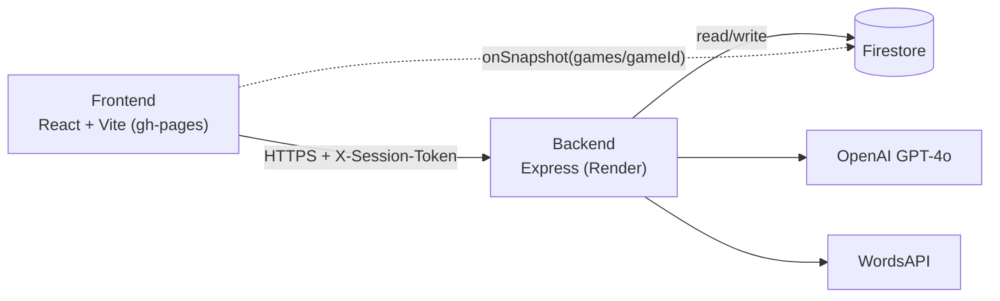
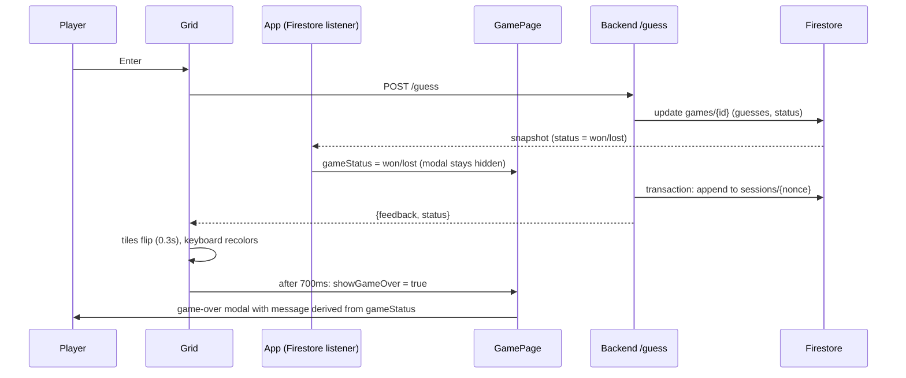
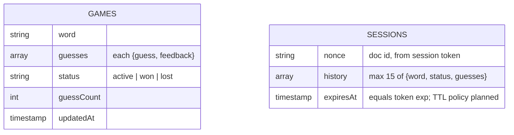

# Data flow

## 1. System overview (built, partial)

The frontend only talks to the backend for anything that costs money or needs a secret. The one direct
Firestore connection is the read-only `onSnapshot` listener in `App.jsx`, which mirrors the game doc
(status, hint, word length) into React state. That second path is why game state can change in the
browser before the HTTP response for the same guess arrives (see flow 2).

## 2. Guess and game over (built)

What it shows and why:
- **Two sources can set `gameStatus`**: the Firestore listener (fires as soon as the backend writes the game doc) and the `/guess` response (arrives after the session-history transaction). The listener usually wins.
- **Message is derived, not stored**: `GamePage` computes the text from `gameStatus` and `targetWord` at render, so it cannot disagree with the status.
- **Modal visibility is its own flag** (`showGameOver`), set only by `Grid` after the response plus `GAME_OVER_DELAY_MS`. An early snapshot therefore cannot show the modal before the tiles finish.
- **Failure**: if `/guess` fails, `showGameOver` is never set, so the modal does not open; `Grid` logs the error and stays unlocked for a retry.

## 3. Firestore data model (built, partial)

`games` is written by `/start` and `/guess`. `sessions` is written only when a game leaves `active`
(transaction, best effort). Nothing reads `sessions` yet (adaptive word selection, step 5, is `planned`),
and the Firestore TTL policy on `sessions.expiresAt` is `planned` (manual console step).
